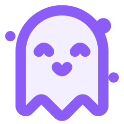
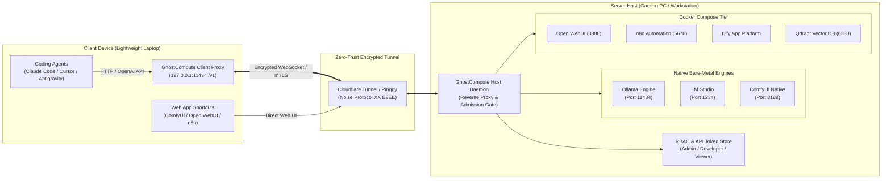

<div align="center">
  
  
  # GhostCompute 👻
  
  **Turn any High-End PC into a Private, Zero-Trust AI & Automation Cloud Server**

  [](LICENSE)
  [](https://tauri.app/)
  [](https://react.dev/)
  [](https://www.rust-lang.org/)
  [](https://www.cloudflare.com/)

  *Enterprise-Grade, Open-Source Unified Desktop & Daemon Application*
</div>

---

## 🌟 Overview

**GhostCompute 👻** allows multiple lightweight client laptops (e.g. business MacBooks, thin clients) to seamlessly harness the heavy GPU compute (NVIDIA CUDA, AMD ROCm, Apple Metal) of a remote gaming PC or workstation from anywhere in the world with **true Zero-Config Setup** and **End-to-End Encryption**.

The same single binary acts in two user-selectable modes:
- **Server Mode (Host):** Hardware auto-detection, one-click catalog orchestrator for 16 AI tools, multi-user role-based access control (RBAC), and persistent zero-trust tunneling via Cloudflare or Pinggy fallback.
- **Client Mode (Consumer):** Automated proxy daemon (`127.0.0.1:11434`), 1-click agent auto-configurator (Claude Code, Cursor, Antigravity, Continue), and connection-aware desktop shortcuts for remote web apps.

---

## ⚡ The GhostCompute Hybrid Model

GhostCompute employs an optimized **Hybrid Architecture**:
1. **Bare-Metal Native Inference Engines (No Docker):**
   - **Ollama, LM Studio, ComfyUI (Native), and cloudflared** run directly on the host OS for maximum tokens/second throughput and direct CUDA/VRAM access without Docker configuration overhead.
2. **Selective Container Orchestration (Docker Compose):**
   - Complex multi-tier web platforms (**Open WebUI, AnythingLLM, n8n, Dify, Activepieces, Flowise, Langflow, Open Interpreter, Tabby, Qdrant**) are managed via automated Docker Compose recipes with isolated data volumes and port bindings.

---

## 🏛️ Architecture & Topology



---

## 📦 Supported 16-Tool Catalog (One-Click)

| Category | Supported Tools | Mode | Highlights |
|---|---|---|---|
| **Local LLM Engines & Inference** | **Ollama**, **LM Studio**, **Jan.ai** | Bare-Metal Native | GPU passthrough, GGUF/Safetensors, `0.0.0.0` binding, OpenAI `/v1` endpoint |
| **AI Chat, RAG & Knowledge** | **Open WebUI**, **AnythingLLM** | Docker Compose | Pre-linked to host Ollama, multi-user document search, vector RAG |
| **Image, Audio & Media Gen** | **ComfyUI**, **Whisper ASR** | Native / GPU Container | Node-based Stable Diffusion workflows, GPU speech-to-text transcription |
| **Workflow & AI Agents** | **n8n**, **Dify**, **Activepieces**, **Flowise**, **Langflow**, **Open Interpreter** | Docker Compose | 400+ automation nodes, visual drag-and-drop agent builders, safe sandbox execution |
| **Coding Assistants & Vector DBs** | **Tabby**, **Twinny Backend**, **Qdrant** | Container / Native | VS Code / JetBrains autocompletion, high-performance vector similarity search |

---

## 🔒 Security & Multi-Tenancy (RBAC)

- **Noise Protocol XX_25519 Encryption:** End-to-end encrypted tunnels over WebSockets; Cloudflare only terminates the outer TLS transport layer without reading payloads.
- **Short Authentication String (SAS):** Visual biometric-style verification string comparison prevents Man-in-the-Middle (MITM) attacks during pairing.
- **Role-Based Access Control (RBAC):** Assign granular permissions (`Admin`, `Developer`, `Viewer`) to paired client devices.
- **Per-Device Rate Limiting & API Tokens:** Cryptographic `gc_live_*` tokens with configurable requests-per-minute (RPM) limits.

---

## 🚀 Quickstart Guide

### 1. Requirements
- **Host PC:** Windows 10/11 or Linux with NVIDIA CUDA, AMD ROCm, or Apple Metal.
- **Client Laptop:** macOS, Linux, or Windows (no GPU required).
- **Tooling:** Node.js 18+ and Rust toolchain installed.

### 2. Build & Launch
```bash
# Clone the repository
git clone https://github.com/John-Varghese-EH/GhostCompute.git
cd GhostCompute

# Install dependencies
npm install

# Run application in development mode
npm run tauri dev

# Compile optimized production release
npm run tauri build
```

### 3. Usage Flow
1. **On Host PC:** Select **Host Server Mode**, click **Start Server**, and copy the generated One-Click Pairing Link.
2. **On Client Laptop:** Select **Client Consumer Mode**, paste the link, and click **Connect**.
3. **Local AI Proxy:** Client services immediately have access to `http://127.0.0.1:11434`.

---

## 🤖 Smart Coding Agent Auto-Configuration

GhostCompute provides one-click environment setups for your favourite coding tools:

### Claude Code CLI
```bash
export OLLAMA_HOST=http://127.0.0.1:11434
claude --provider ollama --model <model-tag>
```

### Cursor & Antigravity
- **Base URL:** `http://127.0.0.1:11434/v1`
- **API Key:** `gc_live_authenticated` (or any string)
- **Model:** Auto-discovered models from remote host

---

## 👤 Author Credits

**John Varghese (J0X)**  
*Principal Systems Architect & Lead Engineer*

- **GitHub:** [https://github.com/John-Varghese-EH](https://github.com/John-Varghese-EH)
- **LinkedIn:** [https://linkedin.com/in/John--Varghese](https://linkedin.com/in/John--Varghese)

---

<div align="center">
  <sub>© 2026 John Varghese (J0X) • GhostCompute 👻 • Licensed under GPLv3</sub>
</div>
