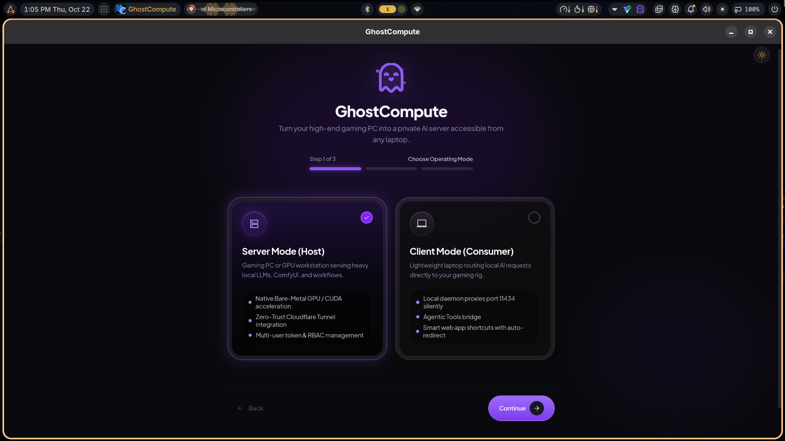
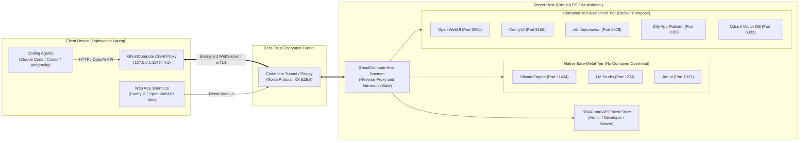

<div align="center">
  
  
  # GhostCompute

  ### Turn your high-end gaming PC into a private AI cloud server accessible from any laptop.

  [](LICENSE)
  [](https://tauri.app/)
  [](https://react.dev/)
  [](https://www.rust-lang.org/)
  [](https://www.cloudflare.com/)

  <br />

  <p align="center">
    <b>Stop paying monthly cloud GPU subscriptions.</b><br />
    Harness the full power of your home workstation's RTX or Radeon GPU while sitting on a coffee shop couch with a MacBook or lightweight ultrabook.
  </p>

  <br />

  

</div>

---

## The Problem GhostCompute Solves

High-performance AI inference and heavy generative models require substantial dedicated VRAM. But carrying a 6-pound gaming laptop with loud fans and a 2-hour battery life is painful, and renting cloud GPUs costs hundreds of dollars every month while exposing your proprietary code and private conversations to external cloud providers.

**GhostCompute gives you the best of both worlds:**
1. **Zero Cloud Costs:** Run 70B LLMs, ComfyUI pipelines, and AI agent workflows completely on the GPU hardware you already own.
2. **Infinite Portability:** Code and chat on a sleek, silent, battery-efficient laptop anywhere in the world.
3. **Drop-in Developer Compatibility:** Seamlessly routes local AI coding tools (Claude Code, Cursor, Continue, Antigravity) through a silent background proxy daemon without changing a single line of your workflow.
4. **Zero-Trust Security:** Built on Noise-XX handshake cryptography (ChaCha20-Poly1305 + Curve25519) and zero-config Cloudflare Tunnels with no open router ports or static IP requirements.

---

## How It Works: Two Modes, One Binary

GhostCompute compiles into a single, lightning-fast native binary that runs in either of two modes:

| | 🖥️ Server Mode (Host) | 💻 Client Mode (Consumer) |
|:---|:---|:---|
| **Where it runs** | Your GPU Workstation / Gaming PC at home or the office | Your MacBook, ThinkPad, Chromebook, or travel ultrabook |
| **What it does** | Drives bare-metal GPU inference, manages 16 open-source AI containers, and orchestrates encrypted tunnels | Silently forwards requests on `127.0.0.1:11434` to your home rig with sub-millisecond local proxy latency |
| **Integrations** | Ollama, LM Studio, ComfyUI, Open WebUI, n8n, Tabby, Dify | Claude Code, Cursor, Antigravity IDE, Continue, Web Browsers |
| **Connection** | Zero-config Cloudflare Quick Tunnel or instant LAN mDNS | One-click pairing with Short Authentication String (SAS) verification |

---

## Architecture: Hybrid Runtime Model

To maximize inference performance while maintaining clean system management, GhostCompute separates workloads into two execution layers:



### 1. Bare-Metal Native Tier (Zero Docker Overhead)
Inference engines (Ollama, LM Studio, Jan.ai) run natively on the host operating system. This guarantees maximum memory bandwidth, direct CUDA/ROCm hardware utilization, and zero container virtualization latency.

### 2. Containerized Application Tier (Docker Compose)
Complex multi-service web platforms (Open WebUI, ComfyUI, AnythingLLM, n8n, Dify, Activepieces, Flowise, Langflow, Open Interpreter, Tabby, Qdrant) are managed via declarative Docker Compose recipes with isolated data volumes and managed port bindings.

---

## One-Click Application Catalog (16 Tools)

GhostCompute includes automated deployment definitions for 16 premier open-source AI tools:

| Category | Supported Services | Deployment Mode | Primary Capability | Default Port |
|:---|:---|:---|:---|:---|
| **Local LLM Engines** | Ollama, LM Studio, Jan.ai | Native Binary | GGUF model execution, bare-metal GPU passthrough, OpenAI `/v1` compatibility | `11434`, `1234`, `1337` |
| **AI Chat & Knowledge** | Open WebUI, AnythingLLM | Docker Container | Multi-user chat workspaces, retrieval-augmented generation (RAG), document ingestion | `3000`, `3001` |
| **Media Generation** | ComfyUI, Whisper ASR | Docker / Native | Node-based Stable Diffusion workflows, GPU speech-to-text transcription | `8188`, `9000` |
| **Workflow Automation** | n8n, Dify, Activepieces | Docker Compose | Low-code workflow automation, agent orchestration, 400+ API integrations | `5678`, `3100`, `8080` |
| **Visual Agent Builders** | Flowise, Langflow, Open Interpreter | Docker Compose | Drag-and-drop LLM pipelines, autonomous computer execution | `3002`, `7860`, `8000` |
| **Coding & Vector Stores** | Tabby, Twinny Backend, Qdrant | Docker / Native | Self-hosted code completion for IDEs, high-performance vector search engine | `8082`, `11434`, `6333` |

---

## Security Model and Multi-Tenancy

GhostCompute incorporates defense-in-depth security principles across all transport and application layers:

- **End-to-End Encryption (Noise Protocol XX):** All peer sessions establish authenticated, end-to-end encrypted tunnels using the Noise XX pattern with Curve25519, ChaCha20-Poly1305, and BLAKE2s. Intermediate tunnel relays (such as Cloudflare or Pinggy) terminate only the outer transport TLS and cannot inspect inner application payloads.
- **Short Authentication String (SAS) Verification:** During initial peer pairing, both devices generate an identical 6-character cryptographic verification string derived from the ephemeral session keys, preventing Man-in-the-Middle (MITM) attacks.
- **Role-Based Access Control (RBAC):** Hosts assign granular permission tiers to connected clients:
  - **Admin:** Full administrative control, service management, model pulling, and client pairing.
  - **Developer:** Unlimited access to AI inference endpoints and development proxies.
  - **Viewer:** Read-only access with restricted request quotas.
- **Cryptographic API Tokens:** Hosts issue revocable `gc_live_*` bearer tokens with configurable requests-per-minute (RPM) rate limiting.
- **VRAM and Compute Guard:** Real-time hardware telemetry monitors GPU temperature, VRAM allocation, and system memory, automatically throttling oversized context requests.

---

## Getting Started

### Prerequisites

- **Host Device:** Windows 10/11 (64-bit) or Linux (x86_64) with dedicated GPU (NVIDIA CUDA recommended).
- **Client Device:** macOS, Linux, or Windows (any lightweight hardware).
- **Development Toolchain:** Node.js 18+ and Rust (stable) installed.

### Build and Launch

```bash
# Clone the repository
git clone https://github.com/John-Varghese-EH/GhostCompute.git
cd GhostCompute

# Install frontend dependencies
npm install

# Run application in development mode
npm run tauri dev

# Compile release package
npm run tauri build
```

---

## Step-by-Step Connection Guide

### Setting up the Host (Server)
1. Launch GhostCompute and select **Server Mode (Host)**.
2. In Step 2 (**LAN Broadcast & Client Pairing**), the application starts hosting on port `8384` and advertises availability across your local network via mDNS (`_ghostcompute._tcp.local.`).
3. Note your displayed local IP address (e.g. `http://192.168.1.150:8384`) or click **Generate PIN** to create a temporary 6-digit code.

### Connecting from a Client (Laptop)
1. Launch GhostCompute on your laptop and select **Client Mode (Consumer)**.
2. Under **Nearby Discovery**, your Host machine will appear automatically. Click **Connect**.
   *(If on a separated subnet or remote network, switch to the Direct IP tab and enter the Host IP address or Cloudflare Tunnel URL).*
3. Verify that the 6-character verification string matches the Host display, and click **Confirm Match**.
4. Both devices are now paired. Your client proxy daemon runs on `http://127.0.0.1:11434`.

---

## Coding Agent Integration

GhostCompute routes developer requests directly to your remote GPU rig without changing local workflows.

### Claude Code CLI
```bash
export OLLAMA_HOST=http://127.0.0.1:11434
claude --provider ollama --model <model-name>
```

### Cursor & Antigravity IDE
Configure local model settings as follows:
- **Base URL:** `http://127.0.0.1:11434/v1`
- **API Key:** `gc_live_authenticated` (or any string)
- **Model Name:** Enter any model installed on your remote host (e.g. `qwen2.5-coder:7b`, `llama3.3:70b`, `deepseek-r1:14b`)

### Continue.dev (VS Code & JetBrains)
```json
{
  "models": [
    {
      "title": "GhostCompute Remote",
      "provider": "ollama",
      "model": "qwen2.5-coder:7b",
      "apiBase": "http://127.0.0.1:11434"
    }
  ]
}
```

---

## Port Allocation Reference

| Port | Service | Protocol | Access Scope |
|:---|:---|:---|:---|
| `8384` | GhostCompute Host Daemon | TCP / WebSocket | LAN / Cloudflare Tunnel |
| `11434` | Ollama Engine (Host) & Local Proxy (Client) | HTTP / REST | Host Internal & Client Localhost |
| `1234` | LM Studio Inference Server | HTTP / REST | Host Localhost |
| `3000` | Open WebUI Dashboard | HTTP | Host / Tunnel |
| `5678` | n8n Automation Engine | HTTP | Host / Tunnel |
| `6333` | Qdrant Vector Database | HTTP / REST | Host / Docker Internal |
| `8188` | ComfyUI Workspace | HTTP / WebSocket | Host / Tunnel |

---

## Author Credits

**John Varghese (J0X)**  
*Principal Systems Architect & Lead Engineer*

- **GitHub:** [https://github.com/John-Varghese-EH](https://github.com/John-Varghese-EH)
- **LinkedIn:** [https://linkedin.com/in/John--Varghese](https://linkedin.com/in/John--Varghese)

---

<div align="center">
  <sub>© 2026 John Varghese (J0X) • GhostCompute • Licensed under GPLv3</sub>
</div>
